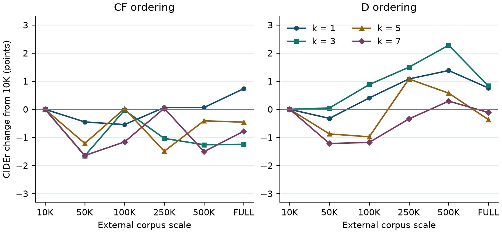
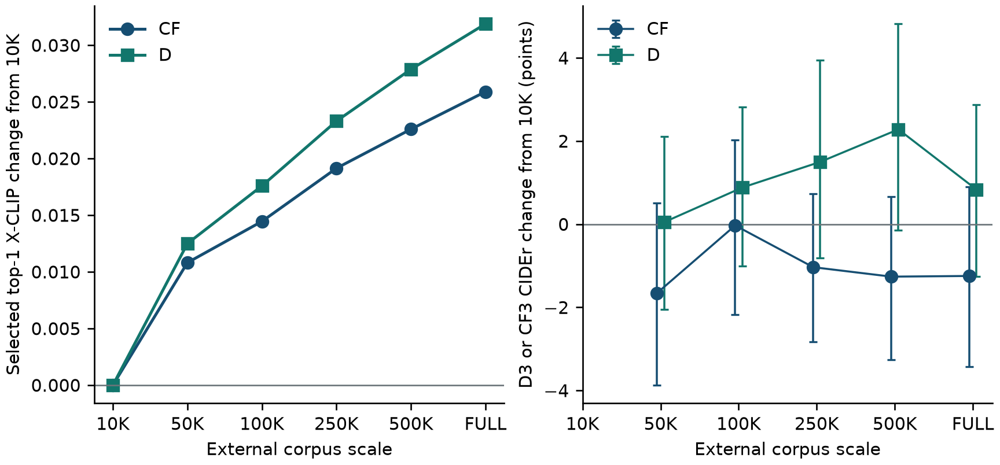
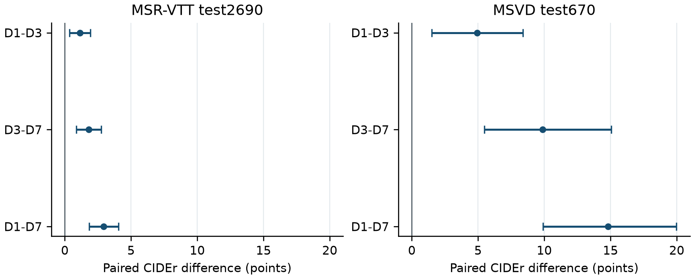
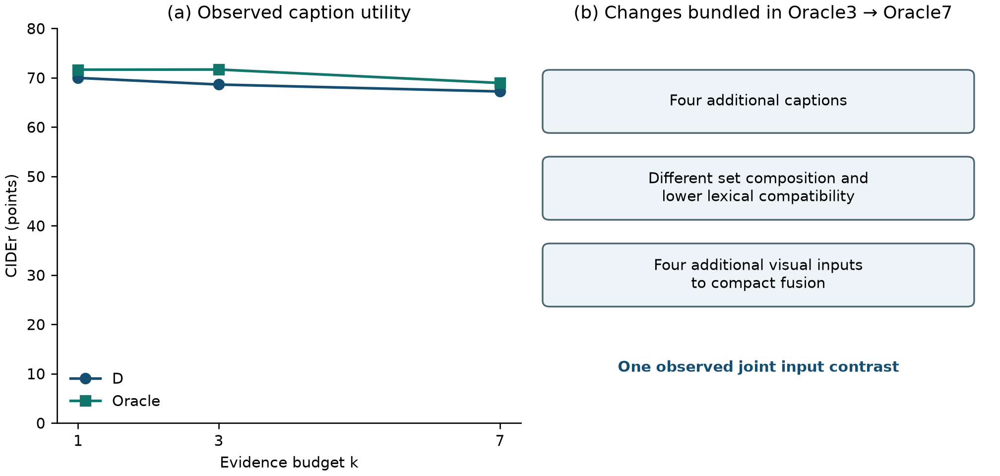
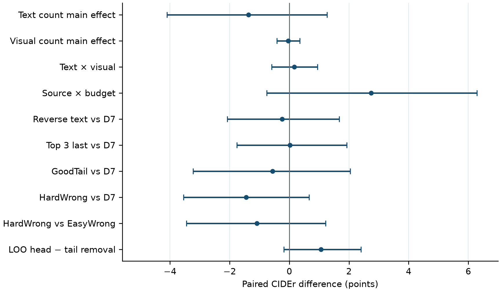

# Diagnosing Million-Scale External Retrieval for Video Captioning

## Abstract

External retrieval gives a video captioner access to more candidate descriptions, but the available evidence may exceed what its generation interface can use effectively. We study this relationship with a fixed retrieval-augmented captioner, six nested subsets of VideoUFO spanning 10,000 to 1,091,712 clips, two candidate orderings, and four text–visual evidence budgets. Larger corpora change the selected candidates and increase retrieval similarity, while fixed-budget generation utility shows no consistent improvement across the scale grid. The budget response is clearer on two test benchmarks. Using three examples instead of seven improves CIDEr by 1.80 points on MSR-VTT and 9.86 points on MSVD, with source-cluster confidence intervals of [0.86, 2.76] and [5.49, 15.05]. The latter comparison extends beyond the inherited MSVD training budget of three. A reference-guided ordering improves three-example generation by 3.04 points over the consensus ordering, yet expanding the same reference-guided prefix from three to seven reduces CIDEr by 2.73 points. These contrasts survive correction within the four-comparison Oracle family and fail to meet the threshold when combined with the exploratory scale-grid family. The longer Oracle prefix changes caption count, candidate composition, and retrieved visual inputs together, so the respective contributions of these factors remain unresolved. The study identifies a practical distinction between improving access to external evidence, selecting useful candidates, and choosing how much evidence to supply to a frozen captioner.

**Keywords.** Video captioning, external retrieval, multimodal evidence, evidence budget, empirical evaluation.

## 1 Introduction

Video captioning requires a model to select which elements of a video matter and express them in a concise description. Retrieval offers a way to supplement the visual signal with examples of how related scenes have been described. In video captioning, those examples can include both captions and corresponding visual features. Fang et al. [@Fang2026EVCap] draw both forms of evidence from the training portion of each benchmark and combine caption reranking with cross-gating. Their in-domain experiment identifies an intermediate evidence count that works well. Applying the same architecture to a large external collection changes the provenance, annotation style, and redundancy of those examples, even when the query encoder and decoder stay fixed.

A larger collection can place a closer candidate within reach. The generation model still receives a short prefix of the retrieved order and combines the corresponding external visual features through a fixed-capacity interface. Candidate similarity measures alignment in the retrieval representation, and reference-overlap measures a different property, namely whether an available candidate resembles observed benchmark descriptions. The relevance of either signal to generation depends on what enters the prompt, how much information the examples share, and how their visual content interacts with the query representation. Increasing corpus scale and increasing input budget therefore address distinct decisions.

We ask how external corpus scale changes access to relevant evidence, how input budget changes the utility of that evidence, and what can be learned by intervening on candidate selection. We study nested external memories with a fixed captioner and distinguish findings on the scale grid from tests on the pilot-excluded MSR-VTT set and on MSVD. We then reorder a common candidate pool using reference compatibility to probe selection headroom. The remaining tests compare competing explanations for the response to larger inputs, including modality count, source, order, and individual examples.

The study makes three contributions.

1. It characterizes corpus scale and evidence budget jointly up to a million underlying external clips and links changes in selected retrieval candidates to same-query generation utility.
2. It quantifies the external budget response on MSR-VTT and MSVD with paired, source-aware inference, accounting for the different operating budgets of the two inherited checkpoints.
3. It measures reference-guided selection headroom and the response to extending the selected prefix, then uses modality, source, order, tail, and removal controls to establish the limits of the resulting explanations.

## 2 Related Work

### 2.1 Retrieval-augmented video captioning

Open-Book captioning retrieves training sentences for a copy–generate decoder and studies sentence counts, corpus fractions, and transfer [@Zhang2021OpenBook]. Fang et al. combine caption reranking with similarity-weighted video fusion and vary the number of retained examples on MSR-VTT [@Fang2026EVCap]. Their Table 4 sweeps retained counts from one to ten and reports a CIDEr peak at seven, with a decline at larger counts. This establishes a direct precedent for budget sensitivity. Our study uses the inherited captioner to examine how that empirical response changes when the evidence comes from an external corpus.

EgoInstructor retrieves instructional video examples for egocentric captioning through a learned cross-view retriever [@Xu2024EgoInstructor]. CM² and HiCM² use cross-modal memory for dense video captioning and study how retrieved features and memory design affect predictions [@Kim2024CM2; @Kim2025HiCM2]. Sali4Vid integrates saliency-aware video processing with adaptive caption retrieval for dense captioning [@Jeon2025Sali4Vid]. These works connect retrieval and the downstream model through training, feature aggregation, localization, or task-specific memory design. Here the unit is clip captioning, and the fixed interface provides a controlled setting for jointly varying external corpus scale and evidence count.

### 2.2 Large external retrieval and evidence utility

SmallCap demonstrates the usefulness of external text memories for lightweight image captioning and includes transfer to video through a multi-frame image representation [@Ramos2023SmallCap]. SURf studies a large image–caption memory together with example counts, rank-dependent distractors, and training for robustness [@Sun2024SURf]. VideoRAG studies retrieval for generation conditioned on queries over video collections [@Jeong2025VideoRAG; @Ren2026VideoRAG]. These applications motivate examining external evidence sources, while the multimodal correspondence in our setting makes the supplied caption and its clip features a coupled input.

RA-Transformer contrasts increasing retrieved-caption overlap with intermediate useful evidence counts for image captioning [@Sarto2022RATransformer]. Related analyses in text QA distinguish passage availability or sufficiency from the ability to generate a correct answer [@Dai2025SePer; @Joren2025SufficientContext]. Datastore scaling can improve language modeling in other settings [@Shao2024MassiveDS]. The distinction relevant here is between a stronger selected retrieval score and the effect of supplying the selected example through a fixed video-captioning interface.

### 2.3 Interference, ordering, and budgeting

Controlled RAG analyses have varied document placement, relevance, and distractors [@Liu2024LostMiddle; @Cuconasu2024PowerNoise]. MAD-RAG studies distraction in multimodal question answering, including cases with answer-containing retrieved text [@Zhao2026MADRAG]. Our tests measure caption differences following input changes. This behavioral design can examine whether the tested position, tail, or modality manipulations reproduce an aggregate deficit. Establishing an attention-level account would require a separate measurement and intervention.

Adaptive retrieval budgets are an established approach. Adaptive-k places a cutoff at an adjacent similarity gap [@Taguchi2025AdaptiveK]. We include a bounded implementation as an operational comparator for fixed budgets. The study's central contribution is the empirical diagnosis of access, budget, and selection in external clip-caption retrieval.

## 3 Study Framework

### 3.1 Fixed multimodal captioner

For query video $v$, let $E_T$ be the supplied retrieved captions and $E_V$ the supplied retrieved-video feature tensors. Following Fang et al. [@Fang2026EVCap], generation takes the form

\[
\widehat y = G_\theta\big(v, P(E_T), F_\theta(v, E_V)\big),
\]

where $P$ formats the textual prompt and $F_\theta$ combines retrieved and query visual features. The visual encoder follows Video-LLaMA and BLIP-2 Q-Former components [@Zhang2023VideoLLaMA; @Li2023BLIP2], with Vicuna-7B-v1.3 as the language model [@LMSYS2023Vicuna13]. Each retrieved video is represented by 32 visual query tokens of dimension 768. The model averages the retrieved features using softmax weights derived from raw X-CLIP similarities, then applies cross-attention and gating with the query visual representation. Adding retrieved videos changes the tensor being aggregated while the aggregate token count remains fixed. In the budget grid, $|E_T|=|E_V|=k$. The factorial diagnostics vary the two counts through their separate input paths. We freeze the captioner, visual feature extraction, fusion parameters, and decoding settings within each benchmark.

### 3.2 External memory and candidate ordering

Our external memory consists of VideoUFO clips and their brief machine-generated captions [@Wang2025VideoUFO; @VideoUFOCard]. The nested manifests contain 10,000, 50,000, 100,000, 250,000, 500,000, and 1,091,712 unique clips. FULL contains 345,437 source videos. The three smallest manifests use one clip per source. The larger manifests can add clips from sources already represented. The sizes describe underlying clips. Retrieval searches groups formed from matching brief-caption strings after trimming surrounding whitespace. Clip correspondence is retained, and the deterministic visual representative is drawn in sorted clip-ID order. This design allows a larger memory to add different clips to the same caption group. The count of candidate groups in the production index requires separate provenance from the number of admitted clips.

For each query, a video-conditioned X-CLIP retriever [@Ni2022XCLIP] scores the brief-caption groups and returns a pool of 20. CF retains the descending raw similarity order. D computes

\[
q_i=\frac{1}{19}\sum_{j\ne i}\mathrm{ROUGE\text{-}L}(c_i,c_j)
\]

over the complete candidate captions and resolves ties by raw retrieval rank. The published predecessor constructs noun-phrase pseudo-labels from the other captions before quality scoring [@Fang2026EVCap, sec. 3.4]. Our full-caption consensus rule is an approximation to that component. D's order uses the consensus score, and its separate similarity file supplies the original X-CLIP scores for visual aggregation. Changing rank is therefore distinct from replacing the weighting function. Main configurations use prefixes $k\in\{1,3,5,7\}$ from each ordering.

### 3.3 Access, reference-guided selection, and adaptive routing

We measure access through selected X-CLIP similarities, changes in the identity of the selected clip lists, and a supplementary best-caption reference-overlap proxy. The latter is computed as the average over queries of the best candidate reference score within each supplied prefix. Its nondecreasing value with prefix length follows from taking a maximum. We therefore use it to describe available matches, while judging generation through the output scores.

The Oracle diagnostic reorders the FULL top-20 pool with reference information. We lowercase and tokenize with `[a-z0-9']+`. The 9,940 validation reference sentences are individual documents for computing unigram document frequency. For token $w$, the inverse document frequency is $\log(N/\mathrm{df}(w))$, using document frequency one when a term is unseen. A candidate's score is the mean cosine similarity of its TF-IDF vector with the individual reference vectors for that query. Raw retrieval rank breaks ties. The generator receives the resulting candidate captions and corresponding visual inputs from prefixes of one, three, or seven. This intervention uses references for candidate ordering. The references themselves serve as evaluation targets, while retrieved descriptions fill the prompt. The ordering optimizes individual lexical compatibility. Standard output CIDEr uses a different tokenization, n-gram orders one through four, and length weighting.

The adaptive comparator chooses the largest adjacent decrease among the first seven similarities in raw X-CLIP order. The selected gap index maps to $\{1,3,5,7\}$ and determines the length of the D-ordered prefix presented to the generator. The rule had no fitted numerical thresholds, although the choice to deploy it was made using earlier validation data. We treat its test results as evidence about this particular routing policy.

## 4 Experimental Setup

### 4.1 Data, checkpoints, and evaluation scope

MSR-VTT uses 6,513 training, 497 validation, and 2,990 test videos [@Xu2016MSRVTT]. We exclude 300 test queries used in development from the principal test comparison, leaving `test2690`. The MSVD split contains 1,200 training, 100 validation, and 670 test videos [@Chen2011MSVD; @Fang2026EVCap]. The MSVD evaluation used the settings chosen on MSR-VTT, with no recorded MSVD-specific budget tuning. These are frozen test outputs evaluated retrospectively. Pilot exclusion reduces direct reuse of development queries, and the archival record is insufficient to call all downstream contrasts prospectively registered or the split source-disjoint from development.

We use the respective inherited checkpoints. The MSR-VTT system was trained with a budget of seven and the MSVD system with a budget of three. The $1\to3$ comparison falls within the observed operating range for MSVD, while $3\to7$ tests extrapolation beyond it. We keep a consistent query frame policy within each comparison, use beam width five and seed 42, retain the same prompt and deterministic correspondence policy, and leave checkpoint weights unchanged. Query retrieval features and retrieved-video features are produced through separate whole-video frame samplers.

Earlier `val497` and 150-query leave-one-out (`val150`) generation used a raw-video evaluation path with a degenerate decode window. Fixing that window restored whole-video decoding, and the validation conditions in this paper use the resulting POST_FIX outputs. The `test2690` and MSVD runs use a separate pre-extracted frame path and retain their existing predictions. The earlier affected validation outputs serve only as provenance. The repaired validation contains the 48 main scale-grid conditions and the modality, selection, source, order, and tail diagnostics. The 150-query subset provides the removal diagnostic.

### 4.2 Measures and inference

We use CIDEr as the primary output measure [@Vedantam2015CIDEr]. Reported output scores and effects are in points, equal to software CIDEr multiplied by 100. We use the same Stanford PTB tokenizer and frozen COCO-style CIDEr implementation for absolute means and paired differences. For a fixed evaluation split, each system shares the same query reference documents and document frequencies. We keep that weighting fixed for primary inference and test the effect of re-estimating it within each resample for the two key Oracle contrasts. Secondary benchmark scores include BLEU, METEOR, ROUGE-L, and SPICE [@Papineni2002BLEU; @Banerjee2005METEOR; @Lin2004ROUGE; @Anderson2016SPICE]. Output length and trigram overlap are descriptive behavior measures. A trigram counts as matched if it occurs in a supplied caption, without joining words across caption boundaries. We compare both the union of supplied captions and the first caption held as a fixed matching reference.

We form paired differences by query and report 95% percentile bootstrap intervals and two-sided sign-flip $p$ values. The independent reanalysis uses 10,000 resamples and 10,000 sign flips per family with a fixed seed. Query-level statistics support comparison with the archived analyses. Source-cluster results resample whole source clusters with all their constituent clips and flip signs jointly by source. There are 361 sources in `val497`, 2,004 in `test2690`, 522 in MSVD test670, and 137 in `val150`. Resampled means weight by the number of sampled queries. These intervals estimate sensitivity to the sampled queries or sources with the actual retrieval corpora held fixed.

We apply Benjamini–Hochberg (BH) separately to the 72 scale-grid comparisons, the four Oracle comparisons, the test-benchmark comparison families (seven in MSR-VTT and six in MSVD), and the separate exploratory diagnostic families. The grid includes four budget contrasts at each corpus–ordering cell and four CF–D contrasts at each scale. Cross-scale and aggregate validation contrasts are reported in a separate exploratory family of 47. The four Oracle tests answer a distinct selection question, with a 76-test sensitivity analysis that combines them with the validation grid. We found no formal preregistration for these families. Confidence intervals are pointwise and do not constitute simultaneous coverage. Sign-flip inference is conditional on the paired differences being sign-exchangeable at the relevant unit under the null.

## 5 Main Results

### 5.1 Joint corpus scale and evidence budget

Table 1 presents the six-scale grid. At fixed $k$, generation utility varies in both directions as corpus size increases. For example, moving from 10K to FULL at $k=3$ changes D by +0.83 CIDEr points (95% source-cluster CI [−1.26, 2.88]) and CF by −1.25 [−3.42, 0.90]. Both orderings can exchange many candidates as the corpus expands, and their mean curves do not follow a common improvement trend (Figure 1). The CF–D comparison is conditional on this experiment's consensus rule and candidate pool. The 72-comparison family gives no evidence for a specific combination of scale and budget at FDR 0.05. The minimum BH-adjusted query-level value is 0.16486 in the independent PTB reanalysis. Reapplying BH to the archived printed $p$ values gives 0.15894, with the same family-level decision.

**Table 1.** POST_FIX CIDEr points for the six nested corpus sizes, two candidate orders, and four paired text–visual budgets on 497 MSR-VTT validation queries.

<!-- begin grid -->
| Scale | CF1 | CF3 | CF5 | CF7 | D1 | D3 | D5 | D7 |
| --- | --- | --- | --- | --- | --- | --- | --- | --- |
| 10K | 70.43 | 70.13 | 69.30 | 68.73 | 69.21 | 67.80 | 67.67 | 67.33 |
| 50K | 69.98 | 68.47 | 68.08 | 67.09 | 68.89 | 67.84 | 66.80 | 66.12 |
| 100K | 69.89 | 70.10 | 69.32 | 67.57 | 69.61 | 68.68 | 66.69 | 66.15 |
| 250K | 70.50 | 69.09 | 67.80 | 68.77 | 70.29 | 69.29 | 68.75 | 66.99 |
| 500K | 70.50 | 68.87 | 68.89 | 67.23 | 70.59 | 70.08 | 68.25 | 67.62 |
| FULL | 71.17 | 68.88 | 68.84 | 67.95 | 69.97 | 68.63 | 67.31 | 67.22 |
<!-- end grid -->

k=1 has the highest observed mean in 11 of the 12 scale–ordering cells, and k=7 has the highest mean in none. Those counts describe one shared validation set under nested corpus designs and shared candidate prefixes. As an exploratory summary, we first average the $k=3$ minus $k=7$ difference across all 12 cells for each query. The resulting mean of +1.59 has a source-cluster interval of [0.23, 2.97] and nominal $p=.0214$. The adjusted $q$ in the 47-test exploratory family is about .503. The contrast helps quantify the budget pattern, while formal evidence for it comes from independent evaluation samples in Section 5.3. The estimated three-way interaction for the 10K and FULL endpoints is −1.41 [−5.16, 2.39]. The grid has limited precision for differences in budget responses across the two orderings and scales.

**Figure 1.** CIDEr change relative to the 10K condition at the same budget and order. The two panels share a zero line and the same scale. Table 1 provides absolute scores. Lines connect nested corpus levels with unequal spacing in clip count.

### 5.2 Access changes without stable downstream returns

At an input budget of three, Figure 2 aligns retrieval and generation on the same queries and the same scale comparisons. From 10K to FULL, the selected top-one clip list changes for 494 of 497 queries in CF and 495 in D. The corresponding mean selected similarity rises by .0259 and .0319. The reported similarities in D are the original X-CLIP scores of the consensus-selected candidates. At the query level, the rank correlations between selected-similarity change and generation CIDEr change are .011 for CF and .007 for D. The fixed-budget generation contrasts are small relative to their uncertainty and go in different directions. These results separate access under the retriever from use of evidence in generation. The estimand is conditional on the observed nested sequence of memories.

**Figure 2.** At fixed $k=3$, mean selected top-one X-CLIP similarity and mean paired generation CIDEr change, each relative to the 10K condition in the same track. Error bars on generation contrasts are 95% source-cluster intervals. The panels have different units.

The archived candidate-only reference-overlap diagnostic also increases across the D7 endpoints, from 13.61 to 18.35 on its ×100 scale. It scores candidate descriptions directly and averages the best one per query within the prefix. We treat it as a candidate-pool proxy because it uses a different scoring population and tokenization from the formal PTB output analysis.

### 5.3 Budget response on MSR-VTT and MSVD

The external D grid shows consistent direction on the two test benchmarks (Table 2). Using three instead of seven examples improves CIDEr by 1.80 points on the pilot-excluded MSR-VTT set and 9.86 on MSVD. On both benchmarks the effect remains positive after source clustering and BH correction in the respective benchmark family (Table 3 and Figure 3). One instead of three examples also improves CIDEr on both. This shorter comparison matters for interpretation because it lies within the inherited MSVD budget, whereas using seven examples on MSVD exceeds that operating budget. Between-benchmark differences in estimated effect size also include changes in checkpoint, reference sets, and query distribution.

**Table 2.** Absolute test CIDEr points from the frozen test predictions. B is a recorded MSR-VTT in-domain retrieval condition. The published MSVD in-domain result and the archival engineering reproduction use different evidence provenance and are described separately in Appendix B.

<!-- begin test_means -->
| Benchmark | Condition | CIDEr |
| --- | --- | --- |
| MSR-VTT | D1 | 71.21 |
| MSR-VTT | D3 | 70.08 |
| MSR-VTT | D5 | 69.48 |
| MSR-VTT | D7 | 68.27 |
| MSR-VTT | Adaptive | 70.67 |
| MSR-VTT | B | 73.09 |
| MSVD | D1 | 156.39 |
| MSVD | D3 | 151.45 |
| MSVD | D5 | 144.39 |
| MSVD | D7 | 141.59 |
| MSVD | Adaptive | 151.94 |
<!-- end test_means -->

**Table 3.** Selected paired test effects with source-cluster inference. BH adjustment uses all seven MSR-VTT or six MSVD contrasts in the respective family, including those listed in the accompanying statistical data.

<!-- begin test_inference -->
| Benchmark | Contrast | Effect | 95% source CI | Source p | Source BH q |
| --- | --- | --- | --- | --- | --- |
| MSR-VTT | D1-D3 | +1.13 | [+0.35, +1.94] | 0.0059 | 0.0083 |
| MSR-VTT | D3-D7 | +1.80 | [+0.86, +2.76] | 0.0002 | 0.0007 |
| MSR-VTT | D1-D7 | +2.93 | [+1.83, +4.06] | 0.0001 | 0.0007 |
| MSR-VTT | Adaptive-D1 | -0.54 | [-1.20, +0.10] | 0.1006 | 0.1006 |
| MSVD | D1-D3 | +4.94 | [+1.50, +8.39] | 0.0046 | 0.0069 |
| MSVD | D3-D7 | +9.86 | [+5.49, +15.05] | 0.0001 | 0.0003 |
| MSVD | D1-D7 | +14.80 | [+9.92, +19.97] | 0.0001 | 0.0003 |
| MSVD | Adaptive-D1 | -4.46 | [-7.68, -1.47] | 0.0030 | 0.0060 |
<!-- end test_inference -->

**Figure 3.** Paired budget effects on the test benchmarks, in CIDEr points with 95% source-cluster intervals. Both panels use the same horizontal scale. This compares responses to external evidence under the frozen checkpoint of each benchmark.

The similarity-gap policy yields intermediate means. Its score is 0.54 points below D1 on MSR-VTT, with an interval that crosses zero, and 4.46 points below D1 on MSVD. The policy improves on some larger fixed budgets, but its practical advantage depends on the fixed comparator. The policy selection predates the correction to the validation generation path, so the favorable contrasts against larger budgets cannot validate that earlier choice procedure. We report small fixed budgets as operational reference settings. The evaluation compares retrieval budgets greater than zero and leaves the value of enabling external retrieval relative to a matched no-evidence mode open.

## 6 Diagnostic Analysis

### 6.1 Selection with reference access

We compare D against the reference-guided ordering at equal budget and compare Oracle prefixes at different budgets. The independent replay matches the archived D and Oracle captions, clip associations, and actual X-CLIP similarity inputs for all 497 queries. The 1-, 3-, and 7-example Oracle conditions consume strict prefixes of the same archived ordered list. Increasing the Oracle count from three to seven keeps the first three examples and adds four corresponding caption–video examples. D and Oracle use a common FULL top-20 pool and the same generator configuration. The identity of the selected clips can differ between orderings.

**Table 4.** Reference-guided contrasts with 95% source-cluster intervals and adjustment within the four Oracle comparisons. The paired query and clustered inference paths use the same PTB output scores.

<!-- begin oracle -->
| Contrast | Effect | 95% source CI | Source p | Source BH q |
| --- | --- | --- | --- | --- |
| Oracle1-D1 | +1.67 | [-0.50, +3.78] | 0.1282 | 0.1531 |
| Oracle3-D3 | +3.04 | [+0.85, +5.27] | 0.0073 | 0.0146 |
| Oracle7-D7 | +1.72 | [-0.62, +4.08] | 0.1531 | 0.1531 |
| Oracle7-Oracle3 | -2.73 | [-4.72, -0.80] | 0.0068 | 0.0146 |
<!-- end oracle -->

At $k=3$, reference-guided ordering improves CIDEr by +3.04 points (source CI [0.85, 5.27]). The longer reference-guided prefix reduces CIDEr by 2.73 points relative to Oracle3 (source CI [−4.72, −0.80]). The two effects survive BH correction within the Oracle family. Query-level $q=.0176$ for both. The combined 76-test sensitivity analysis yields query-level $q=.1368$ for both. Averaging over 999 additional source bootstrap draws with the reference document frequencies re-estimated in each draw gives intervals of [0.78, 5.30] and [−4.87, −0.94]. These checks support a selection headroom result and a joint prefix effect within the defined diagnostic family, with clear sensitivity to a broader definition of multiplicity.

**Figure 4.** Reference-guided ordering and its interpretive scope. (a) Absolute CIDEr means for D and Oracle. Table 4 reports differences and uncertainty. (b) The 3→7 comparison changes candidate composition and visual inputs together with caption count. The boxes describe changes bundled in one controlled input comparison.

Candidate compatibility averages .1380 at ranks 1–3 and .1031 at ranks 4–7. Smooth decline along the order is expected for an individual ranking rule. Across queries, the rank correlation between this head-to-tail drop and the Oracle3−Oracle7 CIDEr effect is .046 (95% source-cluster CI [−.044, .131]). About 60% of the query-level effects are ties. Measuring tail compatibility alone similarly yields a small rank correlation. This analysis bounds association for these lexical proxies and does not estimate how intervening on quality would change the average loss. The added candidates are weaker by construction, and the comparison also changes the visual features entering fusion. Consequently, the Oracle intervention supports the presence of selection headroom and a cost from extending one feasible prefix. The independent effects of text count, evidence composition, and visual input remain unresolved.

### 6.2 Modality and evidence source

The text-by-visual factorial crosses text counts 3 and 7 with visual counts 3 and 7 using the same FULL D order and separate count arguments. The mean textual main effect for adding four captions is −1.37 points (source CI [−4.10, 1.26]), and the visual main effect is −0.04 [−0.42, 0.35]. The interaction is +0.16 [−0.60, 0.94]. The visual interval places a relatively tight bound on the mean effect of changing the number of aggregated visual features in this implementation. The textual interval remains compatible with a practically important deficit. Because the additional text comes from positions 4–7, even a precisely measured main effect here would describe this prefix intervention. A count effect under matched added-caption quality would require an additional contrast.

The matched in-domain control re-extracts corresponding retrieval video features using the same feature protocol. Its D3−D7 difference is −1.34 [−3.59, 0.92], while the external FULL difference is +1.41 [−1.21, 4.17]. The source-by-budget difference in differences is +2.74 [−0.76, 6.29]. This gives directional evidence of different operating responses. It leaves the difference imprecisely estimated and does not distinguish effects of domain alignment from human versus machine annotation, corpus size, or the distribution seen in training.

### 6.3 Order, tail relevance, and individual examples

Reversing prompt order changes CIDEr by −0.24 points (source CI [−2.08, 1.67]), and placing the original top three last changes it by +0.02 [−1.76, 1.92]. The effects center near zero, with intervals that allow some variation under other permutations. A high reference-compatibility tail changes CIDEr by −0.56 [−3.23, 2.04], failing to reproduce the earlier affected-validation result. The high-similarity, low-compatibility tail (HardWrong) changes it by −1.45 [−3.55, 0.66] relative to D7. Compared directly with the lower-similarity control (EasyWrong), the effect is −1.08 [−3.44, 1.22]. These controls vary lexical reference agreement and retrieval similarity, and neither condition provides human-verified labels of misleading evidence.

On the 150-query subset, leave-one-out removes a single caption–video pair from the seven-example list and processes six without refill. Removing the first item has a mean effect of +1.97 [−1.04, 5.11], and removing the last has an effect of −1.51 [−5.28, 1.97]. The mean head-minus-tail removal contrast is +1.06 [−0.18, 2.40]. Across rank removals, the estimates provide limited precision for small or heterogeneous effects. We find no reliable concentration of harm in particular ranks within this diagnostic. Figure 5 summarizes the complementary controls, and Appendix A reports their numerical estimates.

**Figure 5.** Selected diagnostic effects in CIDEr points. Intervals are source-cluster 95% intervals. The removal contrast uses the 150-query subset. Remaining contrasts use the repaired 497-query validation outputs. The zero line supports comparison of magnitude and precision, and the intervals are pointwise.

### 6.4 Output length and lexical reuse

On MSR-VTT test2690, average output length increases from 7.92 to 8.75 words between D1 and D7. The fraction of generated trigrams found in the supplied-caption union increases from .142 to .334. Even when the comparison holds its lexical target to the original top-ranked caption, the fraction rises from .142 to .190. Increasing the available matching vocabulary is therefore insufficient to explain the whole descriptive pattern. On MSVD, mean length rises from 6.77 to 7.61 words. The archived output metrics show higher SPICE at larger budgets on both test sets while CIDEr falls. The metrics emphasize different properties of the text. Trigram reuse, reference similarity, and scene-graph similarity provide no independent verification that the additional words describe the video correctly. The association of lexical reuse with the performance change does not establish mediation.

## 7 Discussion

External memory changes which examples the retriever can select. In a million-clip collection, increasing selected similarity and replacing most top-ranked examples can coexist with broadly stable fixed-budget mean CIDEr. This matters for evaluation because a system that improves an access proxy has solved only the retrieval-side component of the task. A downstream test should also hold the budget constant, track common queries as the corpus grows, and examine whether a retrieved example changes the output. The observation concerns the particular set of nested corpora and fixed generator studied here. It leaves room for improvements with another retrieval representation, a different distribution of evidence, or a different captioner.

The response to supplied evidence count is clearer on the two test benchmarks. A small prefix reduces the number of examples that compete for the prompt and the number of external visual tensors entering aggregation. Smaller prefixes also change which events, objects, and wording the model sees. Our reference-guided intervention shows that more useful selections are available within the same pool, while the factorial and tail controls limit how specifically the resulting deficit can be attributed. The effects of external caption quality, redundancy, annotation style, and fit to training remain open. The in-domain point estimates therefore motivate further controlled comparison without making domain reversal a premise of the study.

These distinctions have practical implications for a system with a fixed decoding interface. Access and ordering should be evaluated independently of the working input budget. Guided selection is a useful diagnostic of opportunities to improve retrieval, while a strong budget baseline helps establish whether a routing policy adds value. Output verification also benefits from inspecting both reference agreement and lexical reuse. A system can produce longer, more evidence-like text without improving consensus against the benchmark references. In this setting the strongest evidence favors comparing against small fixed external budgets and evaluating proposed selection changes directly on frozen test outputs.

## 8 Limitations

The conclusions concern a single inherited captioning architecture and one external collection, with separate fixed checkpoints for the benchmarks. The external brief captions are machine generated, and the study lacks a large-scale human evaluation of their visual relevance or the semantic correctness of generated outputs. Exact source checks reduce one class of overlap concern. Reuploads, near-duplicate footage, and prior model exposure are harder to identify. The full-caption consensus rule also differs from the published noun-phrase reranker, which restricts the interpretation of comparisons with the predecessor.

All studied external budgets supply some retrieval. A matched zero-evidence condition would be needed for an inference about the effect of enabling retrieval. The reference-guided ordering is privileged and primarily lexical. Its prefix changes several inputs at once. The independent modality tests use ordinary D candidates and have limited precision for a textual effect. Selection and set-level utilization are therefore useful behavioral questions with partly overlapping explanations. Most of the validation diagnostics are exploratory and the multiplicity decision depends on the family. In particular, the 150-query removal analysis can miss modest or source-specific effects. Several production details, including the exact derivation of alternate caption-group counts and the runtime hashes of Oracle inputs, remain unarchived. The saved inputs support an independent replay of the archived orderings.

## 9 Conclusion

Under a fixed retrieval-augmented video captioner, expansion to a million underlying external clips improves selected retrieval similarity and changes candidate access while yielding no stable fixed-budget improvement in generation. The budget response is more reproducible across test benchmarks, where shorter external prefixes improve CIDEr. Reference-guided ranking exposes selection headroom, and longer prefixes under that ordering can still reduce utility. The controlled analyses leave the separate contributions of caption count, candidate quality and composition, and visual inputs unresolved. Evaluating these factors separately is important when improvements in retrieval-side access are used to justify adding evidence to a caption generation system.

## Data and Code Availability

The frozen POST_FIX predictions, experiment configurations, and sample-level evidence are archived in the project repository at commit `52b5ed3a69e4b84a8e16ed747f141eefb5b1e2ec`. The independent PTB and source-cluster analyses, data hashes, and replay scripts are archived at commit `d80b0876c8e8ef403e7528be02f75a56c378d40d`. Plot and table generation for this manuscript is included with the supplementary source. [Frozen experiments](https://github.com/Aksnes5/UARCap/tree/52b5ed3a69e4b84a8e16ed747f141eefb5b1e2ec/reports/post_fix) · [Independent analysis and data lineage](https://github.com/Aksnes5/UARCap/tree/d80b0876c8e8ef403e7528be02f75a56c378d40d/reports/local_independent_review)

## Appendix A. Diagnostic Estimates and Evidence Boundaries

**Table A1.** Source-cluster inference for POST_FIX controls. `val497` mechanism effects and `val150` leave-one-out effects are adjusted in separate families of 18 and 8 contrasts. The exact D7 baseline for removal uses its predictions on the same 150 clips and computes the reference weights within that subset.

<!-- begin controls -->
| Contrast | Effect | 95% source CI | Source p | Source BH q |
| --- | --- | --- | --- | --- |
| text_at_v3 | -1.45 | [-4.22, +1.22] | 0.2970 | 0.7349 |
| text_at_v7 | -1.29 | [-4.02, +1.35] | 0.3439 | 0.7349 |
| visual_at_t3 | -0.12 | [-0.78, +0.53] | 0.7404 | 0.9031 |
| visual_at_t7 | +0.04 | [-0.35, +0.50] | 0.8448 | 0.9031 |
| Text count main effect | -1.37 | [-4.10, +1.26] | 0.3154 | 0.7349 |
| Visual count main effect | -0.04 | [-0.42, +0.35] | 0.8529 | 0.9031 |
| Text × visual | +0.16 | [-0.60, +0.94] | 0.7003 | 0.9031 |
| external_D3-D7 | +1.41 | [-1.21, +4.17] | 0.3042 | 0.7349 |
| indomain_D3-D7 | -1.34 | [-3.59, +0.92] | 0.2553 | 0.7349 |
| Source × budget | +2.74 | [-0.76, +6.29] | 0.1322 | 0.7349 |
| Reverse text vs D7 | -0.24 | [-2.08, +1.67] | 0.8061 | 0.9031 |
| Top 3 last vs D7 | +0.02 | [-1.76, +1.92] | 0.9813 | 0.9813 |
| midtail7-D7 | +1.20 | [-0.80, +3.36] | 0.2574 | 0.7349 |
| lowtail7-D7 | -0.64 | [-2.77, +1.36] | 0.5513 | 0.9031 |
| GoodTail vs D7 | -0.56 | [-3.23, +2.04] | 0.6827 | 0.9031 |
| HardWrong vs D7 | -1.45 | [-3.55, +0.66] | 0.1754 | 0.7349 |
| easywrong7-D7 | -0.37 | [-2.35, +1.64] | 0.7259 | 0.9031 |
| HardWrong vs EasyWrong | -1.08 | [-3.44, +1.22] | 0.3675 | 0.7349 |
| remove_rank1 | +1.97 | [-1.04, +5.11] | 0.2201 | 0.8803 |
| remove_rank2 | -0.56 | [-4.64, +3.22] | 0.7854 | 0.9265 |
| remove_rank3 | +0.39 | [-3.24, +3.84] | 0.8357 | 0.9265 |
| remove_rank4 | +0.58 | [-2.98, +4.01] | 0.7588 | 0.9265 |
| remove_rank5 | -0.75 | [-4.31, +2.47] | 0.6764 | 0.9265 |
| remove_rank6 | -0.17 | [-3.68, +3.09] | 0.9265 | 0.9265 |
| remove_rank7 | -1.51 | [-5.28, +1.97] | 0.4236 | 0.9265 |
| LOO head − tail removal | +1.06 | [-0.18, +2.40] | 0.1127 | 0.8803 |
<!-- end controls -->

**Table A2.** Evidence and the scope of interpretation.

| Question | Observation | Scope |
| --- | --- | --- |
| Does external scaling increase access? | Selected similarity and candidate identity change along the nested chain | Similarity is a retrieval proxy and the corpus composition changes with scale |
| Does fixed-budget utility improve consistently? | Endpoint effects change direction by ordering and their intervals cross zero | Inference is conditional on the observed corpus chain |
| Does budget matter on test sets? | Positive D1−D3 and D3−D7 on both benchmarks | MSVD D3−D7 extends beyond the inherited budget |
| Is useful selection available in the top-20 pool? | Oracle3−D3 is positive under the separate Oracle family | Reference access and changes in selected visual evidence constrain deployment and interpretation |
| Does extending the Oracle prefix hurt? | Oracle7−Oracle3 is negative under the separate Oracle family | Candidate count, composition, and associated visuals change jointly |
| Do modality, position or tail explain the response by themselves? | Control intervals vary in precision and cross zero | These tests leave smaller or quality-dependent effects unresolved |

## Appendix B. Result Lineage

**Evaluation routes.** The main article uses corpus-conditioned PTB CIDEr points for both absolute and paired results. Some earlier project summaries apply the CIDEr scorer directly to whitespace-tokenized captions and report, for example, Oracle7−Oracle3 of −2.78. The PTB-based estimate is −2.73. The frozen main-grid JSON and the independent reanalysis both produce zero BH discoveries. Their minimum adjusted values differ because they use different resampling and tokenization inputs. A historical report that gives a minimum above .30 disagrees with its own archived grid. The archived scripts, result hashes, separate figure source, and validation scope make these distinctions traceable.

**Validation and indexing.** A frame-decoder repair applies to raw-video validation paths for `val497` and `val150`. The test sets use the existing pre-extracted frame pathway, and the retrieval caches use separate extraction code. The clip manifest contains 1,091,712 entries. Project records additionally list two caption-group/string counts, 812,932 and 812,014, whose complete production derivations could not be reconstructed. We use the verified clip denominator throughout. The historical manifest records names and configurations for the Oracle inputs and the archived ordering reproduces exactly. The original process invocation and transient input hashes remain unverified.

**Published and archived baselines.** Fang et al. report MSVD CIDEr of 158.1 in the published paper [@Fang2026EVCap, tbl. 1]. A saved engineering reproduction records 158.32. We retain these as separately attributed context, and the main MSVD table uses independently verified current external settings. B on MSR-VTT uses in-domain retrieval. It therefore cannot supply a no-retrieval comparison for this study.

## References

::: {#refs}
:::
