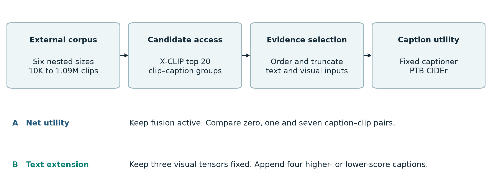
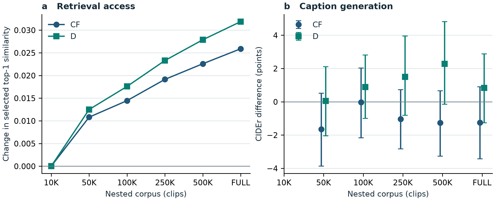
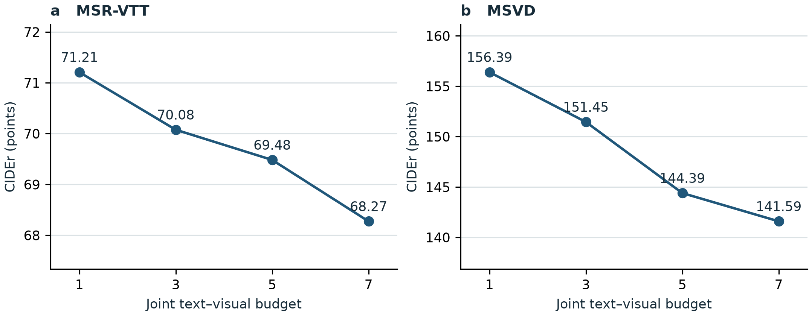
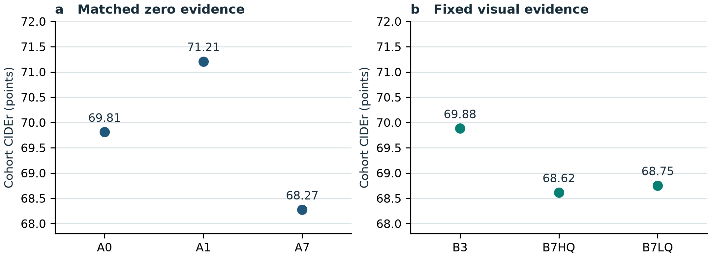
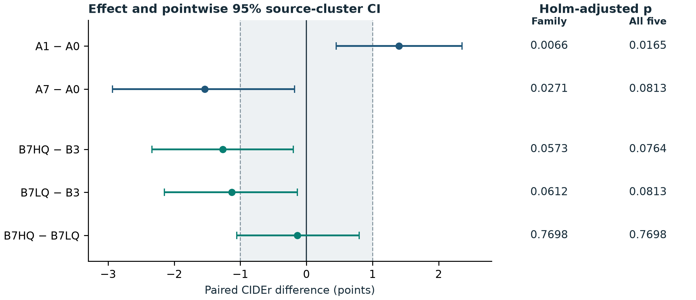

# When Does External Retrieval Help Video Captioning? Evidence Budgets in a Million-Clip Memory

## Abstract

A larger retrieval corpus can supply a closer example without improving the caption generated for the same video. We examine this distinction in a fixed retrieval-augmented video captioner using six nested external memories spanning 10,000 to 1,091,712 clips. Retrieval similarity increased across the endpoints, while generation at fixed budget showed no consistent gain. Three retrieved examples yielded higher CIDEr than seven on MSR-VTT and MSVD. We then tested two interventions specified before new inference on the previously analyzed MSR-VTT benchmark. Relative to a matched zero-evidence condition, one external caption–clip pair improved CIDEr by 1.40 points (95% source-cluster interval [0.45, 2.36]). Seven pairs reduced it by 1.54 points [−2.94, −0.18]. Both comparisons passed correction within this experiment, and only the one-pair benefit survived Holm correction across all five planned tests. With the same three visual tensors, appending four higher- or lower-similarity captions changed CIDEr by −1.27 and −1.13 points. Neither extension passed correction within the text experiment, and the direct contrast between similarity bands was inconclusive. None of the five intervals established an effect beyond the prespecified one-point practical margin. A small external evidence budget thus provided measurable net benefit in this system. Neither retrieval similarity alone nor a general text-overload account explains its response to larger budgets.

**Keywords.** Video captioning, external retrieval, evidence selection, multimodal generation, paired evaluation.

## 1 Introduction

A video captioner can retrieve a scene much like its query and still describe the wrong action. The retriever assigns a similarity score to a candidate. The captioner must decide which details in that candidate apply to the current video. Enlarging a memory changes what is available for selection, while enlarging the evidence budget changes what the generator actually sees. A useful test of external retrieval must distinguish these decisions and measure whether the resulting caption improves over the same system operating without external evidence.

Fang et al. studied caption retrieval from the training portion of each video benchmark. Their cross-gated captioner combines retrieved text with the corresponding visual features, and their experiments already establish that the retained count matters (Fang et al. 2026). We hold the captioning architecture fixed and draw examples from a large external collection of machine-described video clips. This setting tests whether improvements in access translate into generation utility and whether the choice of budget can change the sign of retrieval's net effect.

We track the same queries through six nested corpus scales, evaluate joint caption–video budgets on two benchmarks, and use reference-guided ranking to probe what evidence is available within a fixed candidate pool. A shorter joint prefix can help even if all external settings perform below a zero-evidence baseline. It can also help because of changes to the retrieved visual signal. We address the first ambiguity by retaining the complete fusion pathway at zero external input. We address the second by varying only the supplied captions while verifying the actual visual tensors and intermediate representations for each query.

The study makes three contributions.

1. We link changes in candidate access to paired caption utility across six external corpus scales and four budgets, then quantify the budget response on MSR-VTT and MSVD under their respective inherited checkpoints.
2. We establish a conditional net benefit for one external caption–clip pair on pilot-excluded MSR-VTT using a matched zero-evidence control. We measure the uncertainty of that benefit and the weaker evidence for a loss at seven pairs.
3. We separate reference-guided selection headroom from the response to two specified text extensions. Per-query visual parity permits a behavioral test of the extensions, including a direct comparison between similarity bands. Its uncertainty limits how much of the joint-budget deficit can be attributed to the added captions.

## 2 Related Work

### 2.1 Retrieval-augmented video captioning

Open-Book captioning retrieves training sentences for a copy–generate decoder and studies sentence counts, corpus fractions, and transfer (Zhang et al. 2021). Fang et al. combine caption reranking with similarity-weighted video fusion and vary the number of retained examples on MSR-VTT (Fang et al. 2026). Their Table 4 sweeps retained counts from one to ten and reports a CIDEr peak at seven, with a decline at larger counts. This establishes a direct precedent for budget sensitivity. The predecessor uses seven retained examples for MSR-VTT and three for MSVD. We ask when external evidence adds utility over the same fusion-enabled system with empty external inputs, and whether a text extension recovers the joint-budget response when retrieved visual representations are held fixed.

EgoInstructor retrieves instructional video examples for egocentric captioning through a learned cross-view retriever (Xu et al. 2024). CM² and HiCM² use cross-modal memory for dense video captioning and study how retrieved features and memory design affect predictions (Kim et al. 2024, 2025). Sali4Vid integrates saliency-aware video processing with adaptive caption retrieval for dense captioning (Jeon et al. 2025). These works connect retrieval and the downstream model through training, feature aggregation, localization, or task-specific memory design. Here the unit is clip captioning, and the fixed interface provides a controlled setting for jointly varying external corpus scale and evidence count.

### 2.2 Large external retrieval and evidence utility

SmallCap demonstrates the usefulness of external text memories for lightweight image captioning and includes transfer to video through a multi-frame image representation (Ramos et al. 2023). SURf studies a large image–caption memory together with example counts, rank-dependent distractors, and training for robustness (Sun et al. 2024). VideoRAG studies retrieval for generation conditioned on queries over video collections (Jeong et al. 2025; Ren et al. 2026). These applications motivate examining external evidence sources, while the multimodal correspondence in our setting makes the supplied caption and its clip features a coupled input.

RA-Transformer contrasts increasing retrieved-caption overlap with intermediate useful evidence counts for image captioning (Sarto et al. 2022). Related analyses in text QA distinguish passage availability or sufficiency from the ability to generate a correct answer (Dai et al. 2025; Joren et al. 2025). Datastore scaling can improve language modeling in other settings (Shao et al. 2024). The distinction relevant here is between a stronger selected retrieval score and the effect of supplying the selected example through a fixed video-captioning interface.

### 2.3 Interference, ordering, and budgeting

Controlled RAG analyses have varied document placement, relevance, and distractors (Liu et al. 2024; Cuconasu et al. 2024). MAD-RAG studies distraction in multimodal question answering, including cases with answer-containing retrieved text (Zhao et al. 2026). Our tests measure caption differences following input changes. This behavioral design can examine whether the tested position, tail, or modality manipulations reproduce an aggregate deficit. Establishing an attention-level account would require a separate measurement and intervention.

Adaptive retrieval budgets are an established approach. Adaptive-k places a cutoff at an adjacent similarity gap (Taguchi et al. 2025). We include a bounded implementation as an operational comparator for fixed budgets. The study's central contribution is the empirical diagnosis of access, budget, and selection in external clip-caption retrieval.

## 3 Study Framework

### 3.1 Fixed multimodal captioner

For query video $v$, let $E_T$ be the supplied retrieved captions and $E_V$ the supplied retrieved-video feature tensors. Following Fang et al. (Fang et al. 2026), generation takes the form

$$
\widehat y = G_\theta\big(v, P(E_T), F_\theta(v, E_V)\big),
$$

where $P$ formats the textual prompt and $F_\theta$ combines retrieved and query visual features. The visual encoder follows Video-LLaMA and BLIP-2 Q-Former components (Zhang et al. 2023; Li et al. 2023), with Vicuna-7B-v1.3 as the language model (LMSYS 2023). Each retrieved video is represented by 32 visual query tokens of dimension 768. The model averages the retrieved features using softmax weights derived from raw X-CLIP similarities, then applies cross-attention and gating with the query visual representation. Adding retrieved videos changes the tensor being aggregated while the aggregate token count remains fixed. In the budget grid, $|E_T|=|E_V|=k$. The factorial diagnostics vary the two counts through their separate input paths. We freeze the captioner, visual feature extraction, fusion parameters, and decoding settings within each benchmark.

### 3.2 External memory and candidate ordering

Our external memory consists of VideoUFO clips and their brief machine-generated captions (Wang and Yang 2025; VideoUFO 2025). The nested manifests contain 10,000, 50,000, 100,000, 250,000, 500,000, and 1,091,712 unique clips. FULL contains 345,437 source videos. The three smallest manifests use one clip per source. The larger manifests can add clips from sources already represented. The sizes describe underlying clips. Retrieval searches groups formed from matching brief-caption strings after trimming surrounding whitespace. Clip correspondence is retained, and the deterministic visual representative is drawn in sorted clip-ID order. This design allows a larger memory to add different clips to the same caption group. The count of candidate groups in the production index requires separate provenance from the number of admitted clips.

For each query, a video-conditioned X-CLIP retriever (Ni et al. 2022) scores the brief-caption groups and returns a pool of 20. CF retains the descending raw similarity order. D computes

$$
q_i=\frac{1}{19}\sum_{j\ne i}\mathrm{ROUGE\text{-}L}(c_i,c_j)
$$

over the complete candidate captions and resolves ties by raw retrieval rank. The published predecessor constructs noun-phrase pseudo-labels from the other captions before quality scoring (Fang et al. 2026, sec. 3.4). Our full-caption consensus rule is an approximation to that component. D's order uses the consensus score, and its separate similarity file supplies the original X-CLIP scores for visual aggregation. Changing rank is therefore distinct from replacing the weighting function. Main configurations use prefixes $k\in\{1,3,5,7\}$ from each ordering.

### 3.3 Access, reference-guided selection, and adaptive routing

We measure access through selected X-CLIP similarities, changes in the identity of the selected clip lists, and a supplementary best-caption reference-overlap proxy. The latter is computed as the average over queries of the best candidate reference score within each supplied prefix. Its nondecreasing value with prefix length follows from taking a maximum. We therefore use it to describe available matches, while judging generation through the output scores.

The Oracle diagnostic reorders the FULL top-20 pool with reference information. We lowercase and tokenize with `[a-z0-9']+`. The 9,940 validation reference sentences are individual documents for computing unigram document frequency. For token $w$, the inverse document frequency is $\log(N/\mathrm{df}(w))$, using document frequency one when a term is unseen. A candidate's score is the mean cosine similarity of its TF-IDF vector with the individual reference vectors for that query. Raw retrieval rank breaks ties. The generator receives the resulting candidate captions and corresponding visual inputs from prefixes of one, three, or seven. This intervention uses references for candidate ordering. The references themselves serve as evaluation targets, while retrieved descriptions fill the prompt. The ordering optimizes individual lexical compatibility. Standard output CIDEr uses a different tokenization, n-gram orders one through four, and length weighting.

The adaptive comparator chooses the largest adjacent decrease among the first seven similarities in raw X-CLIP order. The selected gap index maps to $\{1,3,5,7\}$ and determines the length of the D-ordered prefix presented to the generator. The rule had no fitted numerical thresholds, although the choice to deploy it was made using earlier validation data. We treat its test results as evidence about this particular routing policy.

**Figure 1.** Corpus size determines the available candidate pool. Ordering and budget determine which caption–clip associations reach the fixed generator. Experiment A changes both evidence modalities relative to zero. Experiment B holds the visual side fixed at three and varies the text supplied.

## 4 Experimental Setup

### 4.1 Data, checkpoints, and evaluation scope

MSR-VTT uses 6,513 training, 497 validation, and 2,990 test videos (Xu et al. 2016). We exclude 300 test queries used in development from the principal test comparison, leaving `test2690`. The MSVD split contains 1,200 training, 100 validation, and 670 test videos (Chen and Dolan 2011; Fang et al. 2026). The MSVD evaluation used the settings chosen on MSR-VTT, with no recorded MSVD-specific budget tuning. These are frozen test outputs evaluated retrospectively. Pilot exclusion reduces direct reuse of development queries, and the archival record is insufficient to call all downstream contrasts prospectively registered or the split source-disjoint from development.

We use the respective inherited checkpoints. The MSR-VTT system was trained with a budget of seven and the MSVD system with a budget of three. The $1\to3$ comparison falls within the observed operating range for MSVD, while $3\to7$ tests extrapolation beyond it. We keep a consistent query frame policy within each comparison, use beam width five and seed 42, retain the same prompt and deterministic correspondence policy, and leave checkpoint weights unchanged. Query retrieval features and retrieved-video features are produced through separate whole-video frame samplers.

Earlier `val497` and 150-query leave-one-out (`val150`) generation used a raw-video evaluation path with a degenerate decode window. Fixing that window restored whole-video decoding, and the validation conditions in this paper use the resulting POST_FIX outputs. The `test2690` and MSVD runs use a separate pre-extracted frame path and retain their existing predictions. The earlier affected validation outputs serve only as provenance. The repaired validation contains the 48 main scale-grid conditions and the modality, selection, source, order, and tail diagnostics. The 150-query subset provides the removal diagnostic.

### 4.2 Measures and inference

We use CIDEr as the primary output measure (Vedantam et al. 2015). Reported output scores and effects are in points, equal to software CIDEr multiplied by 100. We use the same Stanford PTB tokenizer and frozen COCO-style CIDEr implementation for absolute means and paired differences. For a fixed evaluation split, each system shares the same query reference documents and document frequencies. We keep that weighting fixed for primary inference and test the effect of re-estimating it within each resample for the two key Oracle contrasts. Secondary benchmark scores include BLEU, METEOR, ROUGE-L, and SPICE (Papineni et al. 2002; Banerjee and Lavie 2005; Lin 2004; Anderson et al. 2016). Output length and trigram overlap are descriptive behavior measures. A trigram counts as matched if it occurs in a supplied caption, without joining words across caption boundaries. We compare both the union of supplied captions and the first caption held as a fixed matching reference.

We form paired differences by query and report 95% percentile bootstrap intervals and two-sided sign-flip $p$ values. The independent reanalysis uses 10,000 resamples and 10,000 sign flips per family with a fixed seed. Query-level statistics support comparison with the archived analyses. Source-cluster results resample whole source clusters with all their constituent clips and flip signs jointly by source. There are 361 sources in `val497`, 2,004 in `test2690`, 522 in MSVD test670, and 137 in `val150`. Resampled means weight by the number of sampled queries. These intervals estimate sensitivity to the sampled queries or sources with the actual retrieval corpora held fixed.

We apply Benjamini–Hochberg (BH) separately to the 72 scale-grid comparisons, the four Oracle comparisons, the test-benchmark comparison families (seven in MSR-VTT and six in MSVD), and the separate exploratory diagnostic families. The grid includes four budget contrasts at each corpus–ordering cell and four CF–D contrasts at each scale. Cross-scale and aggregate validation contrasts are reported in a separate exploratory family of 47. The four Oracle tests answer a distinct selection question, with a 76-test sensitivity analysis that combines them with the validation grid. These historical families were specified retrospectively. Confidence intervals are pointwise and do not constitute simultaneous coverage. Sign-flip inference is conditional on the paired differences being sign-exchangeable at the relevant unit under the null.

### 4.3 Two prospectively specified interventions

Both follow-ups use the FULL external corpus, the MSR-VTT checkpoint, identical query order, the inherited prompt template, and the same beam search. We fixed the interventions, input fingerprints, cohorts, endpoint and analysis plan before the six new inference runs. The benchmark and historical budget results were already known. All arms generated outputs for the same 2,990 test queries to allow complete trace checks. The 300 pilot queries were excluded from formal inference.

**Experiment A, matched net utility.** A0 consumes empty external caption and similarity lists. It loads no retrieved visual tensor and supplies an all-zero external aggregate to the attention keys and values. The query video, prompt scaffold, cross-attention, learned gates, projections and decoder remain active. A0 therefore estimates the operating point of the trained retrieval system with empty external evidence. A1 and A7 supply the first one or seven caption–clip pairs in D order. Frames, Q-Former inputs and query projection, training flags, and encoder RNG states matched across arms at every query. Checkpoints and decoding parameters were identical. The primary contrasts are A1−A0 and A7−A0 on 2,690 queries from 2,004 source videos.

**Experiment B, fixed visual evidence.** B3 supplies the D head of three caption–clip pairs. B7HQ and B7LQ retain those captions and the same three visual inputs. Each appends four text-only candidates drawn, respectively, from the eight highest- or eight lowest-scoring remaining candidates in the raw X-CLIP ordering. Each quartet must have four distinct representative sources disjoint from the head. Pairs must separate in mean raw similarity by at least .005. Matching limits total word-count differences and differences in word-set Jaccard overlap with the head and within each quartet. Among qualifying pairs the prespecified rule minimizes normalized imbalances before using the similarity gap and candidate indices to break ties. References and generated outputs have no role in selection. HQ and LQ denote relative similarity bands. Their captions have no human semantic-quality labels.

Of the 2,690 pilot-excluded queries, 2,618 had an eligible matched pair, representing 1,969 sources. The other 72 lacked a balanced separated pair. For those 72 and the 300 pilots all three arms consume the head alone. For each query the traces verify the identities, ordering and hashes of the three actual feature tensors, similarity weights, aggregate, attention keys and values, gate inputs, and visual projections. Only the selected captions and their downstream prompt, token and generation consequences vary. The prespecified contrasts are B7HQ−B3, B7LQ−B3 and B7HQ−B7LQ on the eligible set.

**Follow-up inference.** Official PTB CIDEr uses reference document frequencies fitted separately on each scored cohort, shared by arms within that cohort. Absolute scores from A and B need not be on the same IDF basis. We use 10,000 source-cluster bootstrap draws and 10,000 two-sided source-level sign flips with seed 20261125. Clusters carry all their clips and resampled means weight by sampled clip counts. We control familywise error at .05 with Holm separately for A and B and also across all five primary tests for statements spanning the experiments. A1−A7 is descriptive. A practically clear effect requires an adjusted discovery and a pointwise 95% interval wholly above +1.0 or below −1.0 CIDEr point. A non-discovery does not establish equivalence.

## 5 External Corpus Scale and Joint Evidence Budgets

### 5.1 Joint corpus scale and evidence budget

Table 1 presents the six-scale grid. At fixed $k$, generation utility varies in both directions as corpus size increases. For example, moving from 10K to FULL at $k=3$ changes D by +0.83 CIDEr points (95% source-cluster CI [−1.26, 2.88]) and CF by −1.25 [−3.42, 0.90]. Both orderings can exchange many candidates as the corpus expands, and their mean curves do not follow a common improvement trend. The CF–D comparison is conditional on this experiment's consensus rule and candidate pool. The 72-comparison family gives no evidence for a specific combination of scale and budget at FDR 0.05. The minimum BH-adjusted query-level value is 0.16486 in the independent PTB reanalysis. Reapplying BH to the archived printed $p$ values gives 0.15894, with the same family-level decision.

**Table 1.** POST_FIX CIDEr points for the six nested corpus sizes, two candidate orders, and four paired text–visual budgets on 497 MSR-VTT validation queries.

<!-- begin grid -->
| Scale | CF1 | CF3 | CF5 | CF7 | D1 | D3 | D5 | D7 |
| --- | --- | --- | --- | --- | --- | --- | --- | --- |
| 10K | 70.43 | 70.13 | 69.30 | 68.73 | 69.21 | 67.80 | 67.67 | 67.33 |
| 50K | 69.98 | 68.47 | 68.08 | 67.09 | 68.89 | 67.84 | 66.80 | 66.12 |
| 100K | 69.89 | 70.10 | 69.32 | 67.57 | 69.61 | 68.68 | 66.69 | 66.15 |
| 250K | 70.50 | 69.09 | 67.80 | 68.77 | 70.29 | 69.29 | 68.75 | 66.99 |
| 500K | 70.50 | 68.87 | 68.89 | 67.23 | 70.59 | 70.08 | 68.25 | 67.62 |
| FULL | 71.17 | 68.88 | 68.84 | 67.95 | 69.97 | 68.63 | 67.31 | 67.22 |
<!-- end grid -->

k=1 has the highest observed mean in 11 of the 12 scale–ordering cells, and k=7 has the highest mean in none. Those counts describe one shared validation set under nested corpus designs and shared candidate prefixes. As an exploratory summary, we first average the $k=3$ minus $k=7$ difference across all 12 cells for each query. The resulting mean of +1.59 has a source-cluster interval of [0.23, 2.97] and nominal $p=.0214$. The adjusted $q$ in the 47-test exploratory family is about .503. The contrast helps quantify the budget pattern, while formal evidence for it comes from the two benchmark comparisons in Section 5.3. The estimated three-way interaction for the 10K and FULL endpoints is −1.41 [−5.16, 2.39]. The grid has limited precision for differences in budget responses across the two orderings and scales.

### 5.2 Access changes without stable downstream returns

At an input budget of three, Figure 2 aligns retrieval and generation on the same queries and the same scale comparisons. From 10K to FULL, the selected top-one clip list changes for 494 of 497 queries in CF and 495 in D. The corresponding mean selected similarity rises by .0259 and .0319. The reported similarities in D are the original X-CLIP scores of the consensus-selected candidates. At the query level, the rank correlations between selected-similarity change and generation CIDEr change are .011 for CF and .007 for D. The fixed-budget generation contrasts are small relative to their uncertainty and go in different directions. These results separate access under the retriever from use of evidence in generation. The estimand is conditional on the observed nested sequence of memories.

**Figure 2.** At fixed $k=3$, mean selected top-one X-CLIP similarity and mean paired generation CIDEr change, each relative to the 10K condition in the same track. Error bars on generation contrasts are 95% source-cluster intervals. The panels have different units.

The archived candidate-only reference-overlap diagnostic also increases across the D7 endpoints, from 13.61 to 18.35 on its ×100 scale. It scores candidate descriptions directly and averages the best one per query within the prefix. We treat it as a candidate-pool proxy because it uses a different scoring population and tokenization from the formal PTB output analysis.

### 5.3 Budget response on MSR-VTT and MSVD

The external D grid shows consistent direction on the two test benchmarks (Table 2). Using three instead of seven examples improves CIDEr by 1.80 points on the pilot-excluded MSR-VTT set and 9.86 on MSVD. On both benchmarks the effect remains positive after source clustering and BH correction in the respective benchmark family (Table 3). Figure 3 shows the corresponding means. One instead of three examples also improves CIDEr on both. This shorter comparison matters for interpretation because it lies within the inherited MSVD budget, whereas using seven examples on MSVD exceeds that operating budget. Between-benchmark differences in estimated effect size also include changes in checkpoint, reference sets, and query distribution.

**Table 2.** Absolute test CIDEr points from the frozen test predictions. The archived in-domain comparator uses MSR-VTT training evidence. The published MSVD in-domain result and the archival engineering reproduction use different evidence provenance and are described separately in Appendix B.

<!-- begin test_means -->
| Benchmark | Condition | CIDEr |
| --- | --- | --- |
| MSR-VTT | D1 | 71.21 |
| MSR-VTT | D3 | 70.08 |
| MSR-VTT | D5 | 69.48 |
| MSR-VTT | D7 | 68.27 |
| MSR-VTT | Adaptive | 70.67 |
| MSR-VTT | In-domain | 73.09 |
| MSVD | D1 | 156.39 |
| MSVD | D3 | 151.45 |
| MSVD | D5 | 144.39 |
| MSVD | D7 | 141.59 |
| MSVD | Adaptive | 151.94 |
<!-- end test_means -->

**Table 3.** Selected paired test effects with source-cluster inference. BH adjustment uses all seven MSR-VTT or six MSVD contrasts in the respective family, including those listed in the accompanying statistical data.

<!-- begin test_inference -->
| Benchmark | Contrast | Effect | 95% source CI | Source p | Source BH q |
| --- | --- | --- | --- | --- | --- |
| MSR-VTT | D1-D3 | +1.13 | [+0.35, +1.94] | 0.0059 | 0.0083 |
| MSR-VTT | D3-D7 | +1.80 | [+0.86, +2.76] | 0.0002 | 0.0007 |
| MSR-VTT | D1-D7 | +2.93 | [+1.83, +4.06] | 0.0001 | 0.0007 |
| MSR-VTT | Adaptive-D1 | -0.54 | [-1.20, +0.10] | 0.1006 | 0.1006 |
| MSVD | D1-D3 | +4.94 | [+1.50, +8.39] | 0.0046 | 0.0069 |
| MSVD | D3-D7 | +9.86 | [+5.49, +15.05] | 0.0001 | 0.0003 |
| MSVD | D1-D7 | +14.80 | [+9.92, +19.97] | 0.0001 | 0.0003 |
| MSVD | Adaptive-D1 | -4.46 | [-7.68, -1.47] | 0.0030 | 0.0060 |
<!-- end test_inference -->

**Figure 3.** Absolute CIDEr across joint evidence budgets on pilot-excluded MSR-VTT and MSVD. Each panel has its own vertical scale and benchmark-specific reference documents. Table 3 gives paired uncertainty. MSVD budgets above three exceed that checkpoint's training budget.

The similarity-gap policy yields intermediate means. Its score is 0.54 points below D1 on MSR-VTT, with an interval that crosses zero, and 4.46 points below D1 on MSVD. The policy improves on some larger fixed budgets, but its practical advantage depends on the fixed comparator. The policy selection predates the correction to the validation generation path, so the favorable contrasts against larger budgets cannot validate that earlier choice procedure. We report small fixed budgets as operational reference settings. These archived positive-budget contrasts motivate the matched net-utility test below.

## 6 Net Utility and Fixed-Visual Text Interventions

### 6.1 The same system with zero, one or seven external pairs

One external pair raised CIDEr from 69.81 to 71.21. Seven reduced it to 68.27 (Table 4). A1−A0 was +1.40 points [0.45, 2.36] and remained significant after Holm correction across all five tests. A7−A0 was −1.54 [−2.94, −0.18]. This contrast met the prespecified A-family criterion but missed the five-test criterion. The directions place A0 between A1 and A7 in this checkpoint. For neither contrast does the interval clear the practical margin. The descriptive A1−A7 difference is +2.93 points. Per-query archived D1 and D7 output records match the new A1 and A7 records on all 2,990 queries. They therefore provide a reproducibility check on the endpoints. The matched zero condition supplies the new comparison. The endpoint matches use the same underlying clips and add no independent evaluation sample.

**Table 4.** Follow-up arm means in PTB CIDEr points. A uses 2,690 queries and B uses the 2,618 eligible queries. Prompt length is the observed length of the wrapped model input on the scored B queries, including visual positions.

| Experiment | Arm | Text / retrieved visuals | CIDEr | Mean prompt length |
| --- | --- | --- | ---: | ---: |
| A | A0 | 0 / 0 | 69.81 | — |
| A | A1 | 1 / 1 | 71.21 | — |
| A | A7 | 7 / 7 | 68.27 | — |
| B | B3 | 3 / 3 | 69.88 | 150.69 |
| B | B7HQ | 7 / 3 | 68.62 | 226.86 |
| B | B7LQ | 7 / 3 | 68.75 | 226.38 |

**Figure 4.** Mean caption utility for the two interventions. The zero-evidence condition retains the query and fusion pathway. Both text extensions retain the B3 visual inputs. Comparisons are within panel.

### 6.2 Appending higher- or lower-similarity text to the same visual representation

Both text extensions produced a lower mean CIDEr than B3. B7HQ−B3 was −1.27 [−2.34, −0.20], and B7LQ−B3 was −1.13 [−2.15, −0.14]. The pointwise intervals exclude zero. The corrected tests account for three predeclared comparisons and neither extension reached the B-family .05 criterion (Table 5). The observed decreases are compatible with a cost of these particular additions, without establishing a shared interference mechanism. The equal-count higher-minus-lower contrast was −0.14 [−1.05, 0.80]. This interval includes zero and extends beyond the negative practical margin. The data establish neither a benefit of selecting the higher band nor equivalence between bands.

The matched quartets differed in mean X-CLIP score by .00835 on average (range .00500–.02606, rounded). Mean absolute imbalances were 0.35 words per quartet, .0085 in overlap with the head, and .0074 in within-quartet overlap. The median wrapped prompt contained 148 positions in B3, 224 in B7HQ and 223 in B7LQ. The higher and lower arms differed by +0.48 positions on average, with median absolute difference 3. The two extensions thus presented similarly long prompts, each much longer than B3. Count, length and the particular added content change together in each comparison with B3. Even at equal count, a higher raw score represents a different set of captions and cannot isolate semantic quality.

**Table 5.** All five prespecified paired contrasts, in CIDEr points. Intervals are pointwise 95% source-cluster bootstrap intervals. Raw two-sided sign-flip probabilities and both Holm adjustments use the source as the randomization unit.

| Contrast | Effect | 95% source CI | Raw p | Family Holm p | Five-test Holm p |
| --- | ---: | --- | ---: | ---: | ---: |
| A1−A0 | +1.40 | [+0.45, +2.36] | .0033 | .0066 | .0165 |
| A7−A0 | −1.54 | [−2.94, −0.18] | .0271 | .0271 | .0813 |
| B7HQ−B3 | −1.27 | [−2.34, −0.20] | .0191 | .0573 | .0764 |
| B7LQ−B3 | −1.13 | [−2.15, −0.14] | .0306 | .0612 | .0813 |
| B7HQ−B7LQ | −0.14 | [−1.05, +0.80] | .7698 | .7698 | .7698 |

**Figure 5.** Paired effects for both experiments. The shaded region covers −1 to +1 CIDEr point. No contrast has a 95% interval wholly beyond either practical boundary. The interval and adjusted test answer different questions.

## 7 Selection Headroom and Alternative Explanations

### 7.1 Selection with reference access

We compare D against the reference-guided ordering at equal budget and compare Oracle prefixes at different budgets. The independent replay matches the archived D and Oracle captions, clip associations, and actual X-CLIP similarity inputs for all 497 queries. The 1-, 3-, and 7-example Oracle conditions consume strict prefixes of the same archived ordered list. Increasing the Oracle count from three to seven keeps the first three examples and adds four corresponding caption–video examples. D and Oracle use a common FULL top-20 pool and the same generator configuration. The identity of the selected clips can differ between orderings.

**Table 6.** Reference-guided contrasts with 95% source-cluster intervals and adjustment within the four Oracle comparisons. The paired query and clustered inference paths use the same PTB output scores.

<!-- begin oracle -->
| Contrast | Effect | 95% source CI | Source p | Source BH q |
| --- | --- | --- | --- | --- |
| Oracle1-D1 | +1.67 | [-0.50, +3.78] | 0.1282 | 0.1531 |
| Oracle3-D3 | +3.04 | [+0.85, +5.27] | 0.0073 | 0.0146 |
| Oracle7-D7 | +1.72 | [-0.62, +4.08] | 0.1531 | 0.1531 |
| Oracle7-Oracle3 | -2.73 | [-4.72, -0.80] | 0.0068 | 0.0146 |
<!-- end oracle -->

At $k=3$, reference-guided ordering improves CIDEr by +3.04 points (source CI [0.85, 5.27]). The longer reference-guided prefix reduces CIDEr by 2.73 points relative to Oracle3 (source CI [−4.72, −0.80]). The two effects survive BH correction within the Oracle family. Query-level $q=.0176$ for both. The combined 76-test sensitivity analysis yields query-level $q=.1368$ for both. Averaging over 999 additional source bootstrap draws with the reference document frequencies re-estimated in each draw gives intervals of [0.78, 5.30] and [−4.87, −0.94]. These checks support a selection headroom result and a joint prefix effect within the defined diagnostic family, with clear sensitivity to a broader definition of multiplicity.

Candidate compatibility averages .1380 at ranks 1–3 and .1031 at ranks 4–7. Smooth decline along the order is expected for an individual ranking rule. Across queries, the rank correlation between this head-to-tail drop and the Oracle3−Oracle7 CIDEr effect is .046 (95% source-cluster CI [−.044, .131]). About 60% of the query-level effects are ties. Measuring tail compatibility alone similarly yields a small rank correlation. This analysis bounds association for these lexical proxies and does not estimate how intervening on quality would change the average loss. The added candidates are weaker by construction, and the comparison also changes the visual features entering fusion. Consequently, the Oracle intervention supports the presence of selection headroom and a cost from extending one feasible prefix. The independent effects of text count, evidence composition, and visual input remain unresolved.

### 7.2 Modality and evidence source

The text-by-visual factorial crosses text counts 3 and 7 with visual counts 3 and 7 using the same FULL D order and separate count arguments. The mean textual main effect for adding four captions is −1.37 points (source CI [−4.10, 1.26]), and the visual main effect is −0.04 [−0.42, 0.35]. The interaction is +0.16 [−0.60, 0.94]. The visual interval places a relatively tight bound on the mean effect of changing the number of aggregated visual features in this implementation. The textual interval remains compatible with a practically important deficit. Because the additional text comes from positions 4–7, even a precisely measured main effect here would describe this prefix intervention. Experiment B gives a higher-precision test of two related text-extension policies on a larger cohort. Neither design isolates a pure count effect.

The matched in-domain control re-extracts corresponding retrieval video features using the same feature protocol. Its D3−D7 difference is −1.34 [−3.59, 0.92], while the external FULL difference is +1.41 [−1.21, 4.17]. The source-by-budget difference in differences is +2.74 [−0.76, 6.29]. This gives directional evidence of different operating responses. It leaves the difference imprecisely estimated and does not distinguish effects of domain alignment from human versus machine annotation, corpus size, or the distribution seen in training.

### 7.3 Order, tail relevance, and individual examples

Reversing prompt order changes CIDEr by −0.24 points (source CI [−2.08, 1.67]), and placing the original top three last changes it by +0.02 [−1.76, 1.92]. The effects center near zero, with intervals that allow some variation under other permutations. A high reference-compatibility tail changes CIDEr by −0.56 [−3.23, 2.04], failing to reproduce the earlier affected-validation result. The high-similarity, low-compatibility tail (HardWrong) changes it by −1.45 [−3.55, 0.66] relative to D7. Compared directly with the lower-similarity control (EasyWrong), the effect is −1.08 [−3.44, 1.22]. These controls vary lexical reference agreement and retrieval similarity, and neither condition provides human-verified labels of misleading evidence.

On the 150-query subset, leave-one-out removes a single caption–video pair from the seven-example list and processes six without refill. Removing the first item has a mean effect of +1.97 [−1.04, 5.11], and removing the last has an effect of −1.51 [−5.28, 1.97]. The mean head-minus-tail removal contrast is +1.06 [−0.18, 2.40]. Across rank removals, the estimates provide limited precision for small or heterogeneous effects. We find no reliable concentration of harm in particular ranks within this diagnostic. Appendix A provides all diagnostic estimates.

### 7.4 Output length and lexical reuse

On MSR-VTT test2690, average output length increases from 7.92 to 8.75 words between D1 and D7. The fraction of generated trigrams found in the supplied-caption union increases from .142 to .334. Even when the comparison holds its lexical target to the original top-ranked caption, the fraction rises from .142 to .190. Increasing the available matching vocabulary is therefore insufficient to explain the whole descriptive pattern. On MSVD, mean length rises from 6.77 to 7.61 words. The archived output metrics show higher SPICE at larger budgets on both test sets while CIDEr falls. The metrics emphasize different properties of the text. Trigram reuse, reference similarity, and scene-graph similarity provide no independent verification that the additional words describe the video correctly. The association of lexical reuse with the performance change does not establish mediation.

## 8 Discussion

The zero-evidence score changes the interpretation of budget sensitivity. An ordering of positive-budget means alone cannot tell whether any retrieved example earns its place in the prompt. Here the empty-evidence checkpoint outscored the seven-pair condition on average, yet one pair improved on that same checkpoint. The one-pair gain is the finding with support under both multiplicity scopes. The seven-pair loss is supported within the planned A family and is less secure when both experiments are considered together. This is a conditional decision about using external evidence in a particular trained system, with uncertainty about whether either net change exceeds one point.

The fixed-visual intervention narrows one explanation for that response. In the ordinary joint sweep both the captions and their associated clips enter the generator. Under B, the visual inputs and the computed representation reaching the prompt were identical for each query, and the two selected text extensions each moved the mean down. The estimates point in the direction anticipated by a textual interference account, but neither adjusted test establishes a deficit. Moreover, this intervention changes a three-caption head into a seven-caption input using specially matched quartets. It cannot decompose A1−A7, assign a fraction of the joint deficit to text, or identify an attention bottleneck. The small observed higher-versus-lower difference gives little reason to treat the raw similarity band as a sufficient predictor of the added text's utility.

The scale and selection results help explain why a better retrieval score is an incomplete deployment criterion. Enlarging the corpus replaced almost every top candidate across the scale endpoints while fixed-budget utility varied in both directions. A reference-guided selector could usefully change which three pairs were shown. Even its longer prefix performed worse on repaired validation. For a fixed captioner, three measurements therefore matter. The first measures access to compatible candidates. The other two measure the utility of supplying selected evidence in place of an empty input and the incremental utility of extending the working prefix. A small fixed budget is a competitive operating point here. The evidence does not identify an optimal count for every query.

## 9 Limitations

The two interventions concern one frozen MSR-VTT checkpoint and one machine-captioned external memory. MSVD corroborates the joint budget response under a different inherited checkpoint. It has no matched zero-evidence or fixed-visual follow-up, and seven exceeds its training budget. Memory size, source composition and redundancy covary along one nested chain. Exact-source overlap checks leave near duplicates and pretraining exposure unresolved.

A0 retains retrieval-trained parameters and the fusion pathway. Its comparison cannot predict how a separately trained video-only model would perform. B applies to queries admitting balanced quartets and tests a narrow range of X-CLIP similarity differences. Word overlap and token length provide limited checks on semantic content. Retrieval relevance, visual grounding and perceived caption quality lack human adjudication. The source bootstrap quantifies query-sampling variability conditional on the chosen memory, checkpoint and decoding setup. Pointwise intervals do not establish equivalence or simultaneous coverage. Reference-guided selection shares reference information with the evaluation metric, and the historical diagnostic tests are exploratory. The prospective follow-ups address previously analyzed benchmark material, so external replication remains open.

## 10 Conclusion

Increasing an external memory to a million clips improved retrieval-side access without a consistent fixed-budget gain in caption quality. Shorter joint evidence budgets produced better CIDEr on two test benchmarks. In a matched MSR-VTT intervention, one retrieved pair conferred a net gain over zero external evidence, while seven scored below zero evidence with weaker multiplicity support. At fixed visual input, adding higher- or lower-similarity text produced directional decreases that remained inconclusive after correction. The practical lesson is to evaluate a retrieval budget against both a smaller prefix and the same captioner operating without external evidence. The experiments identify a useful operating point while leaving the mechanism of larger-budget losses open.

## Data and Code Availability

The replication package includes the intervention specifications, raw sealed outputs, Windows integrity receipts, source-cluster contrast tables and figure code. Query references are read from the sealed outputs, with their ordering independently checked against the archive. Historical validation and benchmark sources are retained separately. [Frozen protocol](https://github.com/Aksnes5/UARCap/tree/ee7d3b9876dea94a1ee9eeb2626b92102c85d458/research/uarcap_v06_followup_experiments) · [Raw follow-ups](https://github.com/Aksnes5/UARCap/tree/8ec143b9dd0a3b6f2a03fdd95b3d8ce3016230c0/research/uarcap_v06_followup_deployment/bn_v06_full_ab) · [Formal results and CPU replay](../reports/v07_final) · [Figure sources](v0.7_assets/build_figures.py) · [Historical independent analysis](https://github.com/Aksnes5/UARCap/tree/d80b0876c8e8ef403e7528be02f75a56c378d40d/reports/local_independent_review)

## Appendix A. Diagnostic Estimates and Evidence Boundaries

**Table A1.** Source-cluster inference for POST_FIX controls. `val497` mechanism effects and `val150` leave-one-out effects are adjusted in separate families of 18 and 8 contrasts. The exact D7 baseline for removal uses its predictions on the same 150 clips and computes the reference weights within that subset.

<!-- begin controls -->
| Contrast | Effect | 95% source CI | Source p | Source BH q |
| --- | --- | --- | --- | --- |
| text_at_v3 | -1.45 | [-4.22, +1.22] | 0.2970 | 0.7349 |
| text_at_v7 | -1.29 | [-4.02, +1.35] | 0.3439 | 0.7349 |
| visual_at_t3 | -0.12 | [-0.78, +0.53] | 0.7404 | 0.9031 |
| visual_at_t7 | +0.04 | [-0.35, +0.50] | 0.8448 | 0.9031 |
| Text count main effect | -1.37 | [-4.10, +1.26] | 0.3154 | 0.7349 |
| Visual count main effect | -0.04 | [-0.42, +0.35] | 0.8529 | 0.9031 |
| Text × visual | +0.16 | [-0.60, +0.94] | 0.7003 | 0.9031 |
| external_D3-D7 | +1.41 | [-1.21, +4.17] | 0.3042 | 0.7349 |
| indomain_D3-D7 | -1.34 | [-3.59, +0.92] | 0.2553 | 0.7349 |
| Source × budget | +2.74 | [-0.76, +6.29] | 0.1322 | 0.7349 |
| Reverse text vs D7 | -0.24 | [-2.08, +1.67] | 0.8061 | 0.9031 |
| Top 3 last vs D7 | +0.02 | [-1.76, +1.92] | 0.9813 | 0.9813 |
| midtail7-D7 | +1.20 | [-0.80, +3.36] | 0.2574 | 0.7349 |
| lowtail7-D7 | -0.64 | [-2.77, +1.36] | 0.5513 | 0.9031 |
| GoodTail vs D7 | -0.56 | [-3.23, +2.04] | 0.6827 | 0.9031 |
| HardWrong vs D7 | -1.45 | [-3.55, +0.66] | 0.1754 | 0.7349 |
| easywrong7-D7 | -0.37 | [-2.35, +1.64] | 0.7259 | 0.9031 |
| HardWrong vs EasyWrong | -1.08 | [-3.44, +1.22] | 0.3675 | 0.7349 |
| remove_rank1 | +1.97 | [-1.04, +5.11] | 0.2201 | 0.8803 |
| remove_rank2 | -0.56 | [-4.64, +3.22] | 0.7854 | 0.9265 |
| remove_rank3 | +0.39 | [-3.24, +3.84] | 0.8357 | 0.9265 |
| remove_rank4 | +0.58 | [-2.98, +4.01] | 0.7588 | 0.9265 |
| remove_rank5 | -0.75 | [-4.31, +2.47] | 0.6764 | 0.9265 |
| remove_rank6 | -0.17 | [-3.68, +3.09] | 0.9265 | 0.9265 |
| remove_rank7 | -1.51 | [-5.28, +1.97] | 0.4236 | 0.9265 |
| LOO head − tail removal | +1.06 | [-0.18, +2.40] | 0.1127 | 0.8803 |
<!-- end controls -->

**Table A2.** Evidence and the scope of interpretation.

| Question | Observation | Scope |
| --- | --- | --- |
| Does external scaling increase access? | Selected similarity and candidate identity change along the nested chain | Similarity is a retrieval proxy and the corpus composition changes with scale |
| Does fixed-budget utility improve consistently? | Endpoint effects change direction by ordering and their intervals cross zero | Inference is conditional on the observed corpus chain |
| Does budget matter on test sets? | Positive D1−D3 and D3−D7 on both benchmarks | MSVD D3−D7 extends beyond the inherited budget |
| Is useful selection available in the top-20 pool? | Oracle3−D3 is positive under the separate Oracle family | Reference access and changes in selected visual evidence constrain deployment and interpretation |
| Does extending the Oracle prefix hurt? | Oracle7−Oracle3 is negative under the separate Oracle family | Candidate count, composition, and associated visuals change jointly |
| Do modality, position or tail explain the response by themselves? | Control intervals vary in precision and cross zero | These tests leave smaller or quality-dependent effects unresolved |
| Does external retrieval yield a net gain? | A1 exceeds A0 under both Holm adjustments | One frozen checkpoint, one tested prefix, uncertain practical magnitude |
| Do specified text extensions change utility at fixed vision? | Both estimates are negative, neither meets the B-family Holm criterion | B7HQ−B7LQ is inconclusive, with no human-quality or pure-count interpretation |

## Appendix B. Result Lineage

**Evaluation routes.** The main article uses corpus-conditioned PTB CIDEr points for both absolute and paired results. Some earlier project summaries apply the CIDEr scorer directly to whitespace-tokenized captions and report, for example, Oracle7−Oracle3 of −2.78. The PTB-based estimate is −2.73. The frozen main-grid JSON and the independent reanalysis both produce zero BH discoveries. Their minimum adjusted values differ because they use different resampling and tokenization inputs. A historical report that gives a minimum above .30 disagrees with its own archived grid. The archived scripts, result hashes, separate figure source, and validation scope make these distinctions traceable.

**Validation and indexing.** A frame-decoder repair applies to raw-video validation paths for `val497` and `val150`. The test sets use the existing pre-extracted frame pathway, and the retrieval caches use separate extraction code. The clip manifest contains 1,091,712 entries. Project records additionally list two caption-group/string counts, 812,932 and 812,014, whose complete production derivations could not be reconstructed. We use the verified clip denominator throughout. The historical manifest records names and configurations for the Oracle inputs and the archived ordering reproduces exactly. The original process invocation and transient input hashes remain unverified.

**Published and archived baselines.** Fang et al. report MSVD CIDEr of 158.1 in the published paper (Fang et al. 2026, tbl. 1). A saved engineering reproduction records 158.32. We retain these as separately attributed context, and the main MSVD table uses independently verified current external settings. The historical MSR-VTT in-domain comparator is distinct from the new fixed-visual experiment B. A0 supplies the matched zero-evidence condition.

## References

Anderson, Peter, Basura Fernando, Mark Johnson, and Stephen Gould. 2016. “SPICE: Semantic Propositional Image Caption Evaluation.” *Computer Vision – ECCV 2016*, 382–98. <https://doi.org/10.1007/978-3-319-46454-1_24>.

Banerjee, Satanjeev, and Alon Lavie. 2005. “METEOR: An Automatic Metric for MT Evaluation with Improved Correlation with Human Judgments.” *ACL Workshop on Intrinsic and Extrinsic Evaluation Measures for Machine Translation and/or Summarization*, 65–72. <https://aclanthology.org/W05-0909/>.

Chen, David, and William Dolan. 2011. “Collecting Highly Parallel Data for Paraphrase Evaluation.” In *Proceedings of the 49th Annual Meeting of the Association for Computational Linguistics: Human Language Technologies*, edited by Dekang Lin, Yuji Matsumoto, and Rada Mihalcea. Association for Computational Linguistics. <https://aclanthology.org/P11-1020/>.

Cuconasu, Florin, Giovanni Trappolini, Federico Siciliano, et al. 2024. “The Power of Noise: Redefining Retrieval for RAG Systems.” *Proceedings of the 47th International ACM SIGIR Conference on Research and Development in Information Retrieval*. <https://doi.org/10.1145/3626772.3657834>.

Dai, Lu, Yijie Xu, Jinhui Ye, Hao Liu, and Hui Xiong. 2025. “SePer: Measure Retrieval Utility Through The Lens Of Semantic Perplexity Reduction.” *The Thirteenth International Conference on Learning Representations*. <https://proceedings.iclr.cc/paper_files/paper/2025/hash/c44c4afd77d5ee760e7f4bed0c50f878-Abstract-Conference.html>.

Fang, Chengyang, Jian Li, Yilong Xie, et al. 2026. “Retrieval Augmented video captioning with quality-aware re-ranking and cross-gating fusion.” *Displays* 93: 103420. <https://doi.org/10.1016/j.displa.2026.103420>.

Jeon, MinJu, Si-Woo Kim, Ye-Chan Kim, HyunGee Kim, and Dong-Jin Kim. 2025. “Sali4Vid: Saliency-Aware Video Reweighting and Adaptive Caption Retrieval for Dense Video Captioning.” In *Proceedings of the 2025 Conference on Empirical Methods in Natural Language Processing*, edited by Christos Christodoulopoulos, Tanmoy Chakraborty, Carolyn Rose, and Violet Peng. Association for Computational Linguistics. <https://doi.org/10.18653/v1/2025.emnlp-main.1308>.

Jeong, Soyeong, Kangsan Kim, Jinheon Baek, and Sung Ju Hwang. 2025. “VideoRAG: Retrieval-Augmented Generation over Video Corpus.” In *Findings of the Association for Computational Linguistics: ACL 2025*, edited by Wanxiang Che, Joyce Nabende, Ekaterina Shutova, and Mohammad Taher Pilehvar. Association for Computational Linguistics. <https://doi.org/10.18653/v1/2025.findings-acl.1096>.

Joren, Hailey, Jianyi Zhang, Chun-Sung Ferng, Da-Cheng Juan, Ankur Taly, and Cyrus Rashtchian. 2025. “Sufficient Context: A New Lens on Retrieval Augmented Generation Systems.” *The Thirteenth International Conference on Learning Representations*. <https://proceedings.iclr.cc/paper_files/paper/2025/hash/33dffa2e3d2ab74a783d1a8c292f66d9-Abstract-Conference.html>.

Kim, Minkuk, Hyeon Bae Kim, Jinyoung Moon, Jinwoo Choi, and Seong Tae Kim. 2024. “Do You Remember? Dense Video Captioning with Cross-Modal Memory Retrieval.” *Proceedings of the IEEE/CVF Conference on Computer Vision and Pattern Recognition*, 13894–904. <https://arxiv.org/abs/2404.07610>.

Kim, Minkuk, Hyeon Bae Kim, Jinyoung Moon, Jinwoo Choi, and Seong Tae Kim. 2025. “HiCM2: Hierarchical Compact Memory Modeling for Dense Video Captioning.” *Proceedings of the AAAI Conference on Artificial Intelligence* 39: 4293–301. <https://doi.org/10.1609/aaai.v39i4.32451>.

Li, Junnan, Dongxu Li, Silvio Savarese, and Steven Hoi. 2023. “BLIP-2: Bootstrapping Language-Image Pre-training with Frozen Image Encoders and Large Language Models.” *Proceedings of the 40th International Conference on Machine Learning* 202: 19730–42. <https://proceedings.mlr.press/v202/li23q.html>.

Lin, Chin-Yew. 2004. “ROUGE: A Package for Automatic Evaluation of Summaries.” *Text Summarization Branches Out* (Barcelona, Spain), July, 74–81. <https://aclanthology.org/W04-1013/>.

Liu, Nelson F., Kevin Lin, John Hewitt, et al. 2024. “Lost in the Middle: How Language Models Use Long Contexts.” *Transactions of the Association for Computational Linguistics* (Cambridge, MA) 12: 157–73. <https://doi.org/10.1162/tacl_a_00638>.

LMSYS. 2023. *Vicuna-7B-v1.3 model card and weights version documentation*. <https://huggingface.co/lmsys/vicuna-7b-v1.3>.

Ni, Bolin, Houwen Peng, Minghao Chen, et al. 2022. “Expanding Language-Image Pretrained Models for General Video Recognition.” *Computer Vision – ECCV 2022*, 1–18. <https://doi.org/10.1007/978-3-031-19772-7_1>.

Papineni, Kishore, Salim Roukos, Todd Ward, and Wei-Jing Zhu. 2002. “Bleu: A Method for Automatic Evaluation of Machine Translation.” In *Proceedings of the 40th Annual Meeting of the Association for Computational Linguistics*, edited by Pierre Isabelle, Eugene Charniak, and Dekang Lin. Association for Computational Linguistics. <https://doi.org/10.3115/1073083.1073135>.

Ramos, Rita, Bruno Martins, Desmond Elliott, and Yova Kementchedjhieva. 2023. “SmallCap: Lightweight Image Captioning Prompted With Retrieval Augmentation.” *Proceedings of the IEEE/CVF Conference on Computer Vision and Pattern Recognition*, 2840–49. <https://arxiv.org/abs/2209.15323>.

Ren, Xubin, Lingrui Xu, Long Xia, Shuaiqiang Wang, Dawei Yin, and Chao Huang. 2026. “VideoRAG: Retrieval-Augmented Generation with Extreme Long-Context Videos.” *Proceedings of the 32nd ACM SIGKDD Conference on Knowledge Discovery and Data Mining v.1*, 2390–401. <https://doi.org/10.1145/3770854.3783944>.

Sarto, Sara, Marcella Cornia, Lorenzo Baraldi, and Rita Cucchiara. 2022. “Retrieval-Augmented Transformer for Image Captioning.” *Proceedings of the 19th International Conference on Content-Based Multimedia Indexing*, 1–7. <https://arxiv.org/abs/2207.13162>.

Shao, Rulin, Jacqueline He, Akari Asai, et al. 2024. “Scaling Retrieval-Based Language Models with a Trillion-Token Datastore.” *Advances in Neural Information Processing Systems*. <https://proceedings.neurips.cc/paper_files/paper/2024/hash/a5d8aba27dfef4e849e8cb03fb87a954-Abstract-Conference.html>.

Sun, Jiashuo, Jihai Zhang, Yucheng Zhou, Zhaochen Su, Xiaoye Qu, and Yu Cheng. 2024. “SURf: Teaching Large Vision-Language Models to Selectively Utilize Retrieved Information.” In *Proceedings of the 2024 Conference on Empirical Methods in Natural Language Processing*, edited by Yaser Al-Onaizan, Mohit Bansal, and Yun-Nung Chen. Association for Computational Linguistics. <https://doi.org/10.18653/v1/2024.emnlp-main.434>.

Taguchi, Chihiro, Seiji Maekawa, and Nikita Bhutani. 2025. “Efficient Context Selection for Long-Context QA: No Tuning, No Iteration, Just Adaptive-*k*.” In *Proceedings of the 2025 Conference on Empirical Methods in Natural Language Processing*, edited by Christos Christodoulopoulos, Tanmoy Chakraborty, Carolyn Rose, and Violet Peng. Association for Computational Linguistics. <https://doi.org/10.18653/v1/2025.emnlp-main.1017>.

Vedantam, Ramakrishna, C. Lawrence Zitnick, and Devi Parikh. 2015. “CIDEr: Consensus-Based Image Description Evaluation.” *Proceedings of the IEEE Conference on Computer Vision and Pattern Recognition*, 4566–75. <https://openaccess.thecvf.com/content_cvpr_2015/html/Vedantam_CIDEr_Consensus-Based_Image_2015_CVPR_paper.html>.

VideoUFO. 2025. *VideoUFO dataset card, Brief_Caption and Detailed_Caption schema*. <https://huggingface.co/datasets/VideoUFO/VideoUFO/blob/9ec8b5d/README.md>.

Wang, Wenhao, and Yi Yang. 2025. “VideoUFO: A Million-Scale User-Focused Dataset for Text-to-Video Generation.” *Advances in Neural Information Processing Systems, Datasets and Benchmarks Track*. <https://doi.org/10.52202/085713-0713>.

Xu, Jilan, Yifei Huang, Junlin Hou, et al. 2024. “Retrieval-Augmented Egocentric Video Captioning.” *Proceedings of the IEEE/CVF Conference on Computer Vision and Pattern Recognition*, 13525–36. <https://arxiv.org/abs/2401.00789>.

Xu, Jun, Tao Mei, Ting Yao, and Yong Rui. 2016. “MSR-VTT: A Large Video Description Dataset for Bridging Video and Language.” *Proceedings of the IEEE Conference on Computer Vision and Pattern Recognition*, 5288–96. <https://openaccess.thecvf.com/content_cvpr_2016/html/Xu_MSR-VTT_A_Large_CVPR_2016_paper.html>.

Zhang, Hang, Xin Li, and Lidong Bing. 2023. “Video-LLaMA: An Instruction-Tuned Audio-Visual Language Model for Video Understanding.” In *Proceedings of the 2023 Conference on Empirical Methods in Natural Language Processing: System Demonstrations*, edited by Yansong Feng and Els Lefever. Association for Computational Linguistics. <https://doi.org/10.18653/v1/2023.emnlp-demo.49>.

Zhang, Ziqi, Zhongang Qi, Chunfeng Yuan, et al. 2021. “Open-Book Video Captioning With Retrieve-Copy-Generate Network.” *Proceedings of the IEEE/CVF Conference on Computer Vision and Pattern Recognition*, 9837–46. <https://arxiv.org/abs/2103.05284>.

Zhao, Beidi, Wenlong Deng, Xinting Liao, et al. 2026. “When RAG Hurts: Diagnosing and Mitigating Attention Distraction in Retrieval-Augmented LVLMs.” *Proceedings of the 43rd International Conference on Machine Learning* 306: 161272–90. <https://proceedings.mlr.press/v306/zhao26g.html>.
